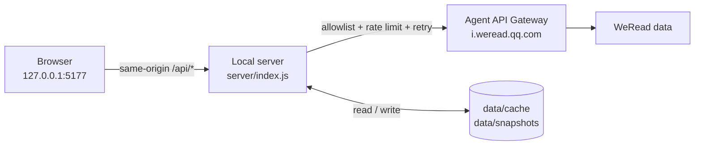

<div align="center">

# WeRead Dashboard

Runs locally · Zero third-party dependencies · API key never leaves the server · All data cached on your machine


[中文文档](README.md) · [Features](#features) · [Quick start](#quick-start) · [Architecture](#architecture) · [Privacy](#privacy--security)

</div>

---

A small dashboard that runs on your own machine and makes your WeChat Reading data readable: how much you read, what you read, which highlights and thoughts you left behind — and lets you **export all of it** at any time.

It talks to the official **WeRead Agent API Gateway** (read-only endpoints only). A local Node service acts as the proxy and caches responses on disk, so the browser only ever talks to `127.0.0.1` — **your API key is never exposed to the page**.

> The full documentation (in Chinese) is in **[README.md](README.md)**.

## Features

- **Six views**: overview, reading stats, shelf, notes & highlights, book details, discover
- **Export notes**: a single book or everything, as Markdown or CSV (UTF-8 BOM, opens cleanly in Excel)
- **Cross-book search** across every synced highlight and thought
- **Long-term trends**: a daily snapshot is written every time stats are fetched
- **Medal wall**: medal metadata comes from the API, the icons are drawn locally (the API ships no icon assets)
- **Zero dependencies**: no npm packages, no build step, no CDN, works offline
- **Read-only & local**: binds `127.0.0.1` only; the gateway offers no write operations anyway

## Screenshots

> Captured from the author's own account; the numbers shown are personal reading history.

| Overview | Shelf |
|---|---|
|  |  |

| Notes & highlights | Book details |
|---|---|
|  |  |

<details>
<summary>More views (top books / recently read / note content)</summary>

| Top books this year | Recently read | Note content by chapter |
|---|---|---|
|  |  |  |

</details>

The stats and discover pages have no screenshot yet — PRs welcome (see [`docs/screenshots/README.md`](docs/screenshots/README.md) for capture and redaction tips).

## Quick start

**Requirements**: Node.js **≥ 18**, plus a WeRead Agent API key.

```bash
# 1. get an API key from https://weread.qq.com/r/weread-skills  (looks like wrk-xxxxxxxx)

# 2. clone and configure
git clone https://github.com/knight02-bit/weread-dashboard.git
cd weread-dashboard
cp .env.example .env          # Windows: copy .env.example .env
#   then edit .env and set WEREAD_API_KEY=wrk-your-key

# 3. run
npm start                     # same as: node server/index.js
```

Open **<http://127.0.0.1:5177/>**.

On Windows you can also just double-click **`start.cmd`** (it reads `PORT` from `.env`, starts the server and opens the browser).

**First run**: click **“同步全部笔记” (Sync all notes)** in the bottom-left corner. Highlights and thoughts for every book are pulled into the local cache (takes a few dozen seconds, with a progress bar). After that, search and export work offline and the page loads instantly from cache.

> The server starts fine without a key: the page will prompt you to fill in `.env` and keep showing cached data.

## Configuration

All configuration lives in `.env` in the project root (parsed by `server/env.js`, no dotenv dependency):

| Variable | Required | Default | Description |
|---|---|---|---|
| `WEREAD_API_KEY` | ✅ | — | WeRead Agent API key, starts with `wrk-` |
| `HOST` | | `127.0.0.1` | Bind address; keep it on loopback |
| `PORT` | | `5177` | Listen port; `start.cmd` reads this value automatically |
| `SYNC_ON_START` | | `1` | Silently warm up shelf / stats / notebooks on boot; `0` disables |

You may also skip `.env` and set `WEREAD_API_KEY` as a system environment variable (`.env` wins, the system variable is the fallback). `.env` and `data/` are git-ignored — never commit them.

## Usage

### Interface

| View | Contents |
|---|---|
| **Overview** | Total / monthly / weekly reading time, daily average, active days, shelf entry count, finished & private counts, note totals; monthly trend, category donut, 24-hour reading-time distribution, top 10 books, recently read |
| **Stats** | Weekly / monthly / yearly / all-time switch (year picker for yearly); time buckets, daily average and period-over-period change, favourite categories / authors / publishers, read-vs-listen split, medal wall, friend ranking, yearly daily heatmap, historical snapshots |
| **Shelf** | Every entry (including the article-collection entry); search by title / author / category, category and status filters, three sort modes; click a card for details |
| **Notes** | Left: every book that has notes (highlight / thought / bookmark counts). Right: highlights grouped by chapter plus thoughts. Export one book or everything; copy highlights in one click |
| **Book** | Cover, intro, rating, word count, publisher, ISBN, reading progress, table of contents, my highlights and thoughts, popular highlights, public reviews, similar books |
| **Discover** | Personalised recommendations, friends' current reads, store search (9 scopes) |

The top search box searches every **synced** highlight and thought across books.

### API examples

```bash
curl -s http://127.0.0.1:5177/api/health
curl -s http://127.0.0.1:5177/api/shelf
curl -s "http://127.0.0.1:5177/api/readdata?mode=monthly"
curl -s "http://127.0.0.1:5177/api/notes/search?keyword=focus"
curl -s -X POST http://127.0.0.1:5177/api/sync
curl -sO -J "http://127.0.0.1:5177/api/export/notes.md?all=1"
```

Any endpoint accepts `?refresh=1` to bypass the cache. The full endpoint list lives in the [Chinese README](README.md#api-参考).

### Scheduled snapshot

```bash
npm run snapshot        # same as: node server/snapshot.js
```

Writes `overall / monthly / annually` stats into `data/snapshots/` without opening the browser — handy for a scheduled task.

## Architecture



1. The browser only talks to the local service and **never sees the API key**.
2. The server forwards only the gateway's 17 read-only endpoints (allowlist) — it is not an open proxy.
3. Upstream calls are rate limited (concurrency 3, 120 ms gap, 2 retries) to avoid triggering abuse protection.
4. Cache hits are returned with `cached: true`; if upstream fails but a stale entry exists, the old data is served with a warning.

## Privacy & security

- **The key never reaches the browser** — all upstream calls are made server-side; `public/` contains no secrets.
- **Loopback only** — binds `127.0.0.1` by default; other devices on your LAN cannot reach it.
- **Read-only** — the gateway exposes no write operations, so nothing in your library can be modified.
- **Data stays local** — cache and snapshots live in `data/`; no third-party server is involved.
- Do not expose the service to the internet: it has no authentication by design.

## Known limitations

- Read-only: query and export only, no shelf edits, thoughts or deletions.
- Bookmarks have no content — the API only reports their count.
- Some fields (friend ranking, medals) are returned for specific `mode` values only; the UI degrades gracefully.
- Single-user tool: no login, no multi-user support.
- Upstream fields are trimmed by the gateway and may change; `upgrade_info` in a response means the `weread-skills` version should be bumped.
- Only tested on Windows with Node 20/24. `start.cmd` is Windows-only; use `npm start` elsewhere (the code itself is platform-agnostic).

## Contributing

Issues and PRs are welcome. Please keep the two core constraints: **zero third-party dependencies** and **no build step**. Before opening a PR, make sure `npm start` runs, the browser console is clean, and neither `.env` nor `data/` was committed.

## License

[MIT](LICENSE) © 2026 knight02-bit

## Disclaimer

This is a personal, third-party tool. It is not affiliated with or endorsed by Tencent / WeChat Reading. It uses the official WeRead Agent API — please respect their terms of service, use it to view your own data only, and never share or publicly deploy your API key.
