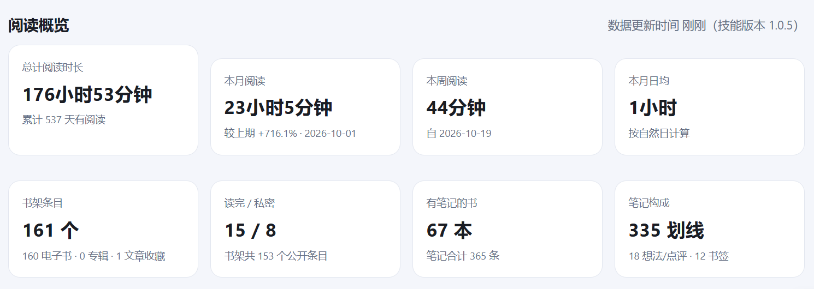
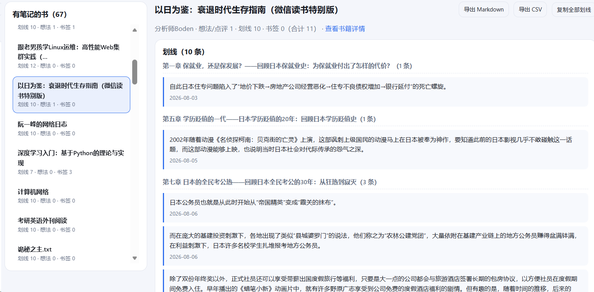
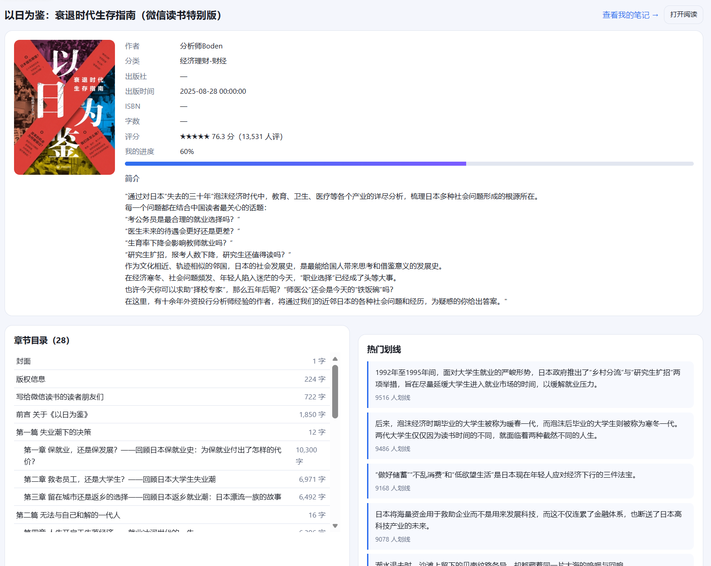
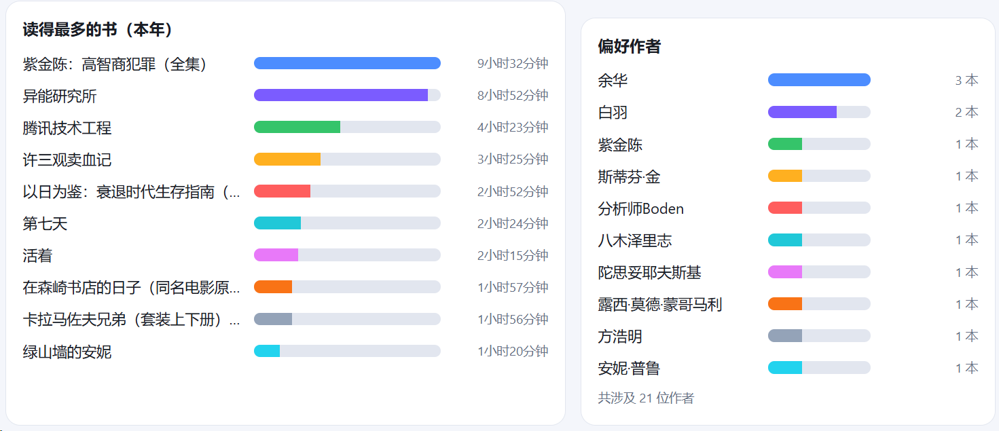
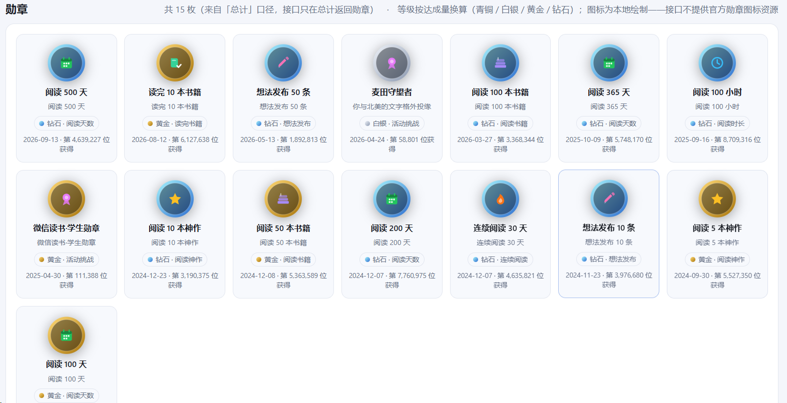
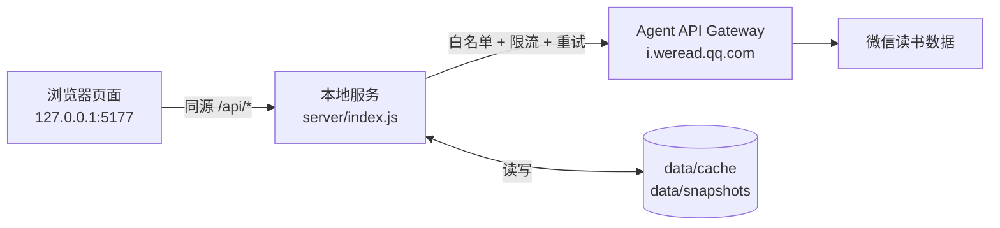

<div align="center">

# 微信读书个人数据看板

本地运行 · 零第三方依赖 · API Key 只留在服务端 · 数据全部缓存在本机


[快速开始](#快速开始) · [特性](#特性) · [截图](#截图) · [配置](#配置) · [工作原理](#工作原理) · [API](#api-参考) · [常见问题](#常见问题) · [English](README.en.md)

</div>

---

一个跑在本机的小型看板，用来把自己在微信读书里的阅读数据看清楚：读了多少、读什么、留下了哪些划线和想法，并且**随时可以导出**。

它通过微信读书的 **Agent API Gateway**（全部为只读接口）取数，由一个本地 Node 服务代理并在磁盘上做缓存，网页端只与本机服务通信——**API Key 永远不会出现在浏览器里**。

## 特性

- **六个视图**：概览、阅读统计、书架、笔记与划线、书籍详情、发现
- **笔记可导出**：单本或全部导出 Markdown / CSV（CSV 带 UTF-8 BOM，Excel 直接打开不乱码）
- **跨书检索**：在已同步的划线与想法里做全文搜索
- **长期趋势**：每次拉取统计自动落一次每日快照，可对比阅读时长的变化
- **勋章墙**：15 项成就的文字数据来自接口，图标由本项目本地绘制（接口不提供图标资源）
- **零依赖**：不使用任何第三方 npm 包，不需要构建步骤，不引用 CDN，离线可用
- **只读且安全**：仅监听 `127.0.0.1`，不暴露到局域网；网关本身也不提供写操作

## 截图

> 截图为作者本人的真实账号，仅用于展示功能；其中的数字属于个人阅读记录。

| 概览 | 书架 |
|---|---|
|  |  |

| 笔记与划线 | 书籍详情 |
|---|---|
|  |  |

<details>
<summary>更多界面细节（读得最多的书 / 最近在读 / 笔记内容）</summary>

| 读得最多的书（本年） | 最近在读 | 笔记内容（按章节） |
|---|---|---|
|  |  |  |

</details>

「阅读统计」「发现」两个页面暂未配图，欢迎 PR 补充（截图与脱敏建议见 [`docs/screenshots/README.md`](docs/screenshots/README.md)）。

## 快速开始

**前置要求**：Node.js **≥ 18**（已实测 v20.19.5 与 v24.22.0）、一个微信读书 Agent API Key。

**第一步：拿到 API Key**

访问 <https://weread.qq.com/r/weread-skills>，获取形如 `wrk-xxxxxxxx` 的 Key。

**第二步：配置**

```bash
git clone https://github.com/knight02-bit/weread-dashboard.git
cd weread-dashboard
cp .env.example .env      # Windows: copy .env.example .env
```

编辑 `.env`，填入你的 Key：

```ini
WEREAD_API_KEY=wrk-你的Key
```

**第三步：启动**

```bash
npm start                 # 等价于 node server/index.js
```

Windows 用户也可以直接双击 **`start.cmd`**（会自动启动服务并打开浏览器）。

然后访问 **<http://127.0.0.1:5177/>**。

**第四步：首次同步**

进入后点左下角 **「同步全部笔记」**，把每本书的划线与想法拉到本地缓存（几十秒，进度条实时显示）。
同步完成后，跨书搜索和导出都可以离线进行；之后再打开页面会直接读缓存，秒开。

> 没配置 Key 也能启动：页面会提示去填 `.env`，已缓存的数据照常浏览。

## 配置

配置集中在项目根目录的 `.env`（由 `server/env.js` 自行解析，不依赖 dotenv）：

| 变量 | 必填 | 默认值 | 说明 |
|---|---|---|---|
| `WEREAD_API_KEY` | ✅ | — | 微信读书 Agent API Key，`wrk-` 开头 |
| `HOST` | | `127.0.0.1` | 监听地址，建议保持本机回环 |
| `PORT` | | `5177` | 监听端口，`start.cmd` 会自动读取该值拼浏览器地址 |
| `SYNC_ON_START` | | `1` | 启动时后台静默同步书架 / 统计 / 笔记本；`0` 关闭 |

补充：

- 也支持不写 `.env`，改用系统环境变量 `WEREAD_API_KEY`（`.env` 优先，系统变量兜底）。
- `.env` 已被 `.gitignore` 忽略，**不要提交**；换 Key 只需改 `.env` 后重启服务。
- 端口冲突时改 `PORT` 即可，不用改代码。

## 使用

### 界面

| 页面 | 内容 |
|---|---|
| **概览** | 总计 / 本月 / 本周阅读时长、日均、有效阅读天数、书架条目数、读完与私密数、笔记总量；月度趋势、偏好分类环形图、24 小时阅读时段、单本时长 Top 10、最近在读 |
| **阅读统计** | 本周 / 本月 / 本年 / 总计切换（本年可选年份）；时长分桶明细、日均与环比、偏好分类 / 作者 / 出版社、阅读与听书占比、勋章墙、好友排行、年度每日热力图、历史快照 |
| **书架** | 全部条目（含文章收藏入口）；按书名 / 作者 / 分类搜索、分类筛选、在读 / 已读完 / 私密筛选、三种排序；点卡片进入书籍详情 |
| **笔记与划线** | 左侧列出所有有笔记的书（含划线 / 想法 / 书签三类计数）；右侧按章节分组的划线原文与想法点评；导出单本或全部；一键复制划线 |
| **书籍详情** | 封面、简介、评分、字数、出版社、ISBN；阅读进度；章节目录；我的划线 / 想法；热门划线；公开点评（全部 / 推荐 / 不行 / 最新 / 一般）；相似推荐 |
| **发现** | 为你推荐（可换一批）、朋友在读动态、书城检索（全部 / 电子书 / 网文 / 听书 / 作者 / 全文 / 书单 / 公众号 / 文章） |

顶部搜索框用于**跨书检索已同步的划线与想法**；左下角「清空缓存」可强制下次重新拉取。

### 接口示例

```bash
# 服务状态（是否已加载 Key、上游调用次数、缓存条目数）
curl -s http://127.0.0.1:5177/api/health

# 书架（含归一化计数）
curl -s http://127.0.0.1:5177/api/shelf

# 本月阅读统计
curl -s "http://127.0.0.1:5177/api/readdata?mode=monthly"

# 跨书检索划线 / 想法
curl -s "http://127.0.0.1:5177/api/notes/search?keyword=财富"

# 触发全量同步并轮询进度
curl -s -X POST http://127.0.0.1:5177/api/sync
curl -s http://127.0.0.1:5177/api/sync/status

# 导出全部笔记
curl -sO -J "http://127.0.0.1:5177/api/export/notes.md?all=1"
```

Windows PowerShell：

```powershell
Invoke-RestMethod http://127.0.0.1:5177/api/health
Invoke-RestMethod "http://127.0.0.1:5177/api/readdata?mode=overall" | Select-Object -ExpandProperty data
```

任何接口都可以加 `?refresh=1` 强制绕开缓存重新拉取。

### 命令行快照

想用计划任务长期留档，可以不开网页直接跑：

```bash
npm run snapshot        # 等价于 node server/snapshot.js
```

它会拉取 `overall / monthly / annually` 三个口径并写入 `data/snapshots/`。示例（Windows，每天 23:50）：

```powershell
schtasks /create /tn "WereadDashboardSnapshot" /tr "node <项目路径>\server\snapshot.js" /sc daily /st 23:50
```

## 项目结构

```
.
├─ .env.example             配置样例（.env 不入库）
├─ start.cmd                Windows 一键启动（自动读取 .env 里的 PORT）
├─ package.json             仅用于 npm start / npm run snapshot，无任何依赖
├─ server/                  本地服务端（CommonJS，零依赖）
│  ├─ index.js              HTTP 服务：静态文件 + /api 路由，仅绑定 127.0.0.1
│  ├─ env.js                .env 解析
│  ├─ weread.js             网关客户端：17 个接口白名单、并发限流、重试、超时、错误中文化
│  ├─ cache.js              文件缓存 + 每日快照
│  ├─ routes.js             全部 /api 端点、归一化口径、导出逻辑
│  └─ snapshot.js           命令行快照脚本
├─ public/                  前端（原生 HTML/CSS/JS，无构建、无 CDN）
│  ├─ index.html
│  ├─ styles.css            深色 / 浅色双主题，含窄屏适配
│  ├─ util.js               格式化工具（时长、时间戳、转义等）
│  ├─ api.js                /api 客户端（同源优先，file:// 时回退到 127.0.0.1）
│  ├─ charts.js             手写 SVG 图表（柱状 / 环形 / 排行 / 热力图）
│  ├─ medal-icons.js        本地绘制的勋章图标
│  ├─ app.js                路由、主题、状态栏、同步进度
│  └─ views/                dashboard · stats · shelf · notes · book · discover
└─ data/                    运行期生成（缓存与快照，不入库）
```

## 工作原理



要点：

1. 浏览器只与本机服务通信，**看不到 API Key**；Key 仅存在于服务端进程内存中。
2. 服务端只放行网关的 17 个只读接口（白名单），不提供任意转发。
3. 上游请求做了限流（并发 3、间隔 120 ms、失败重试 2 次），避免触发风控。
4. 命中缓存时直接返回并标注 `cached: true`；上游失败时若有旧缓存，会降级返回旧数据并给出提示。

## API 参考

| 端点 | 说明 |
|---|---|
| `GET /api/health` | 服务状态、Key 是否加载、上游调用统计、同步进度 |
| `GET /api/shelf` | 书架（归一化计数：`total = books + albums + mp`） |
| `GET /api/notebooks` | 笔记本概览（游标翻页自动拉全） |
| `GET /api/readdata?mode=weekly\|monthly\|annually\|overall&baseTime=` | 阅读统计 |
| `GET /api/book/:bookId` | 书籍信息 + 章节目录 + 阅读进度 |
| `GET /api/book/:bookId/marks` | 我的划线（按章节分组） |
| `GET /api/book/:bookId/reviews` | 我的想法 / 点评（自动翻页拉全） |
| `GET /api/book/:bookId/best` | 热门划线 |
| `GET /api/book/:bookId/similar` | 相似推荐 |
| `GET /api/book/:bookId/reviews-public?type=&maxIdx=` | 公开点评 |
| `GET /api/recommend` | 个性化推荐 |
| `GET /api/discover` | 朋友在读动态 |
| `GET /api/search?keyword=&scope=&maxIdx=` | 书城检索（9 个 scope） |
| `GET /api/notes/search?keyword=` | 在本地缓存中跨书检索划线 / 想法 |
| `POST /api/sync` · `GET /api/sync/status` | 全量同步笔记（后台任务，可轮询进度） |
| `GET /api/export/notes.md` · `notes.csv` | 导出笔记，支持 `?bookId=` 或 `?all=1` |
| `GET /api/snapshots?mode=` | 历史统计快照 |
| `POST /api/cache/clear` | 清空本地缓存 |

响应统一信封：`{ ok, data, cached, stale, savedAt, warning, upgradeInfo }`；出错时 `{ ok: false, error: { code, message } }`（`code` 取值如 `NO_KEY` / `UNAUTHORIZED` / `RATE_LIMITED` / `OFFLINE`）。

## 数据口径

这些口径与微信读书技能文档保持一致，也是本项目最容易踩坑的地方：

- **书架条目数** = `books` + `albums`(专辑 / 有声书) + `mp`(文章收藏入口)；只有明确要「电子书」时才用 `books.length`。
- **笔记数** = `reviewCount`(想法 / 点评) + `noteCount`(划线) + `bookmarkCount`(书签)；`noteCount` 只是划线条数，不是总笔记数。
- **书签没有内容**：接口已过滤书签，只能统计数量，无法导出书签正文。
- **阅读时长单位是秒**，总量以 `totalReadTime` 为准；`readTimes` 只用于明细展示，不要拿来求和当总量。
- **勋章只在 `mode=overall` 返回**，且可展示勋章不少于 3 个时才有；图标由本项目本地绘制（接口不提供图标资源）。
- **时间戳**统一显示为 `YYYY-MM-DD`（必要时加 `HH:mm`）。
- **链接**只使用回包字段：有 `readerLink` → 打开阅读，否则 `deepLink` → 查看详情，不自行拼接。
- 回包中出现 `upgrade_info` 时，页面顶部会提示先升级 `weread-skills` 技能版本。

## 缓存策略

| 数据 | TTL |
|---|---|
| 书架 | 30 分钟 |
| 笔记本概览 | 6 小时 |
| 阅读统计 | 30 分钟（同时写当日快照） |
| 单本划线 / 想法 | 24 小时 |
| 书籍信息 / 章节目录 / 热门划线 | 24 小时 |
| 阅读进度 | 30 分钟 |
| 推荐 / 好友动态 | 6 小时 / 1 小时 |
| 书城搜索 | 不缓存（实时） |

缓存文件在 `data/cache/`，快照在 `data/snapshots/`，都是纯 JSON，可以直接查看或删除。清空方式：网页左下角「清空缓存」、`POST /api/cache/clear`，或直接删目录。

## 隐私与安全

- **Key 不下发**：浏览器拿不到 API Key，所有上游请求都由本地服务发出；`public/` 里不含任何密钥。
- **只监听本机**：默认绑定 `127.0.0.1`，局域网内其他设备访问不到。
- **只读**：网关不提供写操作，本项目也不会修改你的书架、笔记或想法。
- **数据留在本机**：缓存与快照都在 `data/`，不经过任何第三方服务器。
- **别把 Key 提交上去**：`.env`、`data/` 已在 `.gitignore` 中；分享日志或截图前记得脱敏。
- 不建议把服务暴露到公网，也不建议加公网反代——它没有登录与鉴权设计。

## 常见问题

| 现象 | 处理 |
|---|---|
| 页面提示「无法连接本地服务」 | 服务没启动：`npm start`，或双击 `start.cmd`，然后刷新页面 |
| 顶部红色「未配置 API Key」 | `.env` 缺失或 `WEREAD_API_KEY` 为空；填好后重启服务（此时页面仍可看缓存数据） |
| 401 / Key 无效或已失效 | Key 过期或写错，去 <https://weread.qq.com/r/weread-skills> 重新获取 |
| 提示触发限流 | 等 1–2 分钟再操作，别频繁点「同步全部笔记」 |
| 端口被占用 | 改 `.env` 里的 `PORT`（`start.cmd` 会自动读取） |
| 想强制更新数据 | 书架页「刷新书架」、左下角「清空缓存」，或给任意接口加 `?refresh=1` |
| 阅读时段图显示「暂无时段数据」 | 上游在部分口径不返回 `preferTime`，属正常降级 |
| 书籍进度显示 0% | 上游 `progress` 就是 0（如未开始阅读），不是解析错误 |

## 已知限制

- **只读**：能做的是查与导出，不能改书架、发想法或删笔记。
- **书签无正文**：接口不返回书签内容，只能统计数量。
- **金额 / 排行等字段**：部分字段（如好友排行、勋章）只在特定口径返回，界面会相应降级或提示。
- **单用户**：没有登录、多用户与权限设计，定位就是本机个人工具。
- **上游字段可能变动**：网关回包经过裁剪，若微信读书调整字段，个别模块可能需要跟进；回包带 `upgrade_info` 时按提示升级 `weread-skills`。
- **平台实测**：仅在 Windows + Node 20/24 上实测过；`start.cmd` 是 Windows 专用，macOS / Linux 用 `npm start`（代码本身无平台相关逻辑）。

## 参与贡献

欢迎 Issue 与 PR：

1. Fork 并新建分支：`git checkout -b feat/your-feature`
2. 保持**零第三方依赖**与**无构建步骤**这两个约束（这是本项目的核心取舍）
3. 提交前自查：`npm start` 能正常起来、浏览器控制台无报错、`.env` 与 `data/` 没有被提交
4. 提交 PR，说明动机与验证方式

## 许可证

[MIT](LICENSE) © 2026 knight02-bit

## 免责声明

本项目是个人自用的第三方工具，与腾讯 / 微信读书官方无任何关联，也未获得其背书。
所用接口为微信读书官方提供的 Agent API，请遵守其服务条款，仅用于查看自己的数据，不要分享或公开部署你的 API Key。

## 致谢

- 接口字段含义与统计口径参考微信读书官方 `weread-skills` 技能文档（`skill_version 1.0.5`）
- 前端图表、勋章图标均为手写 SVG，无任何第三方库
